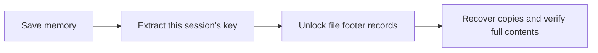

# C3RB3R / .L0CK3D ransomware rescue

English | [简体中文](README_CN.md)

**NAS files renamed to `.L0CK3D`, with `read-me3.txt` appearing in folders? Preserve the scene first. Recovery may still be possible.**

This repository helps you or your AI assistant stop further damage, save memory, find recovery keys and restore copies. There are successful [PVE](docs/incident-report.md) and [community physical DSM](https://github.com/soimy/c3rb3r-rescue/issues/14) cases. When no key can be found, some Btrfs files may still be recovered from old data blocks. **What survives depends on your system; there is no universal key.**

> **Do not reboot, power off, upgrade, reinstall or `kill -9` the encryptor first.** Its memory may still hold recovery material. Do not delete ciphertext, snapshots or the recycle bin to free space, and do not write recovered files back to the affected storage pool.

## What to do immediately

1. **Stop encryption while preserving the process.** Identify the malicious process before using `sudo kill -STOP PID`, replacing `PID` with its verified process ID. Check that every thread is `T`; `D` means waiting for I/O, not successfully stopped. Names can change: do not suspend or kill processes in bulk based on a name alone.
2. **Contain access and synchronization.** Block NAS access to the Internet and other devices, checking both IPv4 and IPv6. Pause cloud and shared-folder synchronization to limit propagation. For remote work, first preserve a trusted console or restricted SSH connection so you retain access.
3. **Save memory and the executable promptly.** Do not wait for a full inventory or vulnerability attribution. Use independent storage with enough space; verify the mount before writing. Keep large dumps out of `/tmp` and the affected data volume. Choose a capture route below.
4. **Test a few independent ciphertext copies.** Look for intact copies of the same versions on computers, phones, in email or Git clones. Compare full SHA-256 digests or every byte before expanding recovery. Keep the original ciphertext throughout.
5. **Restore service in a clean environment.** Recovering data does not make the compromised NAS trustworthy. Follow recovery with rebuilding, credential replacement and remediation of the entry point.

If you are unfamiliar with SSH or processes, give this page to an administrator or AI assistant using the prompt below. Do not reboot the affected system to prepare tools.

## Choose your recovery route

| Your situation | Next step |
|---|---|
| **DSM runs in PVE and is still powered on** | Preserve guest memory from the trusted host, then search offline. See [containment and PVE memory](skills/dsm-ransomware-rescue/references/containment-memory.md) (Chinese). |
| **Physical DSM, encryptor still alive** | Stop and verify all threads, save process memory first, then assess whole-system capture. Follow the [physical-machine guide](skills/dsm-ransomware-rescue/references/physical-memory.md). |
| **Process gone, machine not rebooted** | Promptly preserve available RAM and actually used swap. Do not assume the key survives. Also check snapshots, other copies and the Btrfs route below. |
| **No usable key, data volume is Btrfs** | Preserve existing snapshots and assess whether surviving file ranges still reference older data blocks. See [Btrfs recovery without keys](skills/dsm-ransomware-rescue/references/btrfs-recovery.md). |
| **Already powered off or rebooted** | Restarting cannot recover the previous process memory. Preserve disks, existing dumps, snapshots and other copies; Btrfs recovery still needs assessment. |

**“Never rebooted” does not mean “the key is still present”; “process exited” does not mean “all data is lost.”** Community reports include successes and searches with no key found. See [cases and verification limits](docs/community-findings.md).

## Why recovery can work

The analyzed program generates encryption material for each file, protects it with a **session key**, and stores the protected record at the end of the file. The session key may remain in the encryptor's memory. A matching key can unlock those records and allow file recovery without obtaining the attacker's private key.

A separate route needs no key: **Btrfs copy-on-write may retain data blocks from before the overwrite**. If untouched parts of a file still reference those blocks, reconstruction may be possible. Actual extent mappings, snapshots and subsequent writes determine whether this works; a Btrfs or NoCOW label alone is insufficient. See [crt106's explanation](https://github.com/crt106/c3rb3r-btrfs-recovery/blob/b831f3a0f718677b889f2998ff09a0b925baa56b/skills/c3rb3r-btrfs-recovery/references/principles.md) and [our verification limits](skills/dsm-ransomware-rescue/references/btrfs-recovery.md).

## Has it worked for anyone?

- **This repository's PVE case:** a key recovered from memory restored an approximately 49 GiB GitLab weekly backup that matched its historical digest. An isolated restore recovered **80 projects**.
- **[Benjamin-zlt's physical-machine case](https://github.com/Benjamin-zlt/c3rb3r-baremetal-rescue/blob/906e81293153341f162ee1f176722d93ba1d8358/docs/case-report.md):** the author reports recovering about 84,500 files and checking a sample against known originals, using that machine's own key.
- **[Community Btrfs tools](https://github.com/crt106/c3rb3r-btrfs-recovery):** an alternative that reconstructs files from older blocks without a key. Verification varies between reports; file counts do not mean every file was compared byte for byte.

These tools target an analyzed sample and format. [Other victims' reports](https://github.com/soimy/c3rb3r-rescue/issues/14) have prompted physical-machine capture fixes and support for explicit session markers, but always test a few copies first. The repository also publishes [one recovery candidate from our case](docs/key-sharing.md); there is currently no evidence that it decrypts another victim's files.

## A prompt for your AI assistant

> Read this repository's README and skills/dsm-ransomware-rescue/SKILL.md. Help me respond to a suspected C3RB3R / .L0CK3D incident. First establish the machine type, reboot history, encryptor state, management channel and independent destination storage. Within existing authorization, contain further damage and prioritize memory and executable preservation; do not kill a stopped encryptor. Validate candidate keys and full files on independent copies first. If no key is available, assess snapshots and Btrfs old-block recovery. Do not automatically reboot, execute malware or write to the affected volume. Clearly distinguish verified results from candidates.

Add your system version, physical/virtual setup, discovery time, reboot history and available backups. **Do not publish passwords, memory dumps, keys or business files.**

## When you need commands or deeper detail

| Task | Guide |
|---|---|
| Capture physical-machine memory; inspect LiME dumps | [Physical-machine guide](skills/dsm-ransomware-rescue/references/physical-memory.md) |
| Assess Btrfs recovery without a key | [Conditions, workflow and verification](skills/dsm-ransomware-rescue/references/btrfs-recovery.md) |
| Set up analysis tools, inspect footers, decrypt copies | [Tool usage and maintenance](docs/tool-usage.md) |
| Understand community successes, failures and scope | [Community findings](docs/community-findings.md) |
| Understand key reuse | [Key hierarchy and public candidate](docs/key-sharing.md) |
| Study algorithms, memory addresses and repeated encryption | [Reverse engineering and decryption](skills/dsm-ransomware-rescue/references/reverse-decrypt.md) (Chinese) |
| Inventory files or restore GitLab | [Inventory and verification](skills/dsm-ransomware-rescue/references/inventory-verify.md) · [Isolated restore](skills/dsm-ransomware-rescue/references/gitlab-restore.md) (Chinese) |
| Read this incident's forensic records | [Incident report](docs/incident-report.md) · [Attack path](docs/attack-path.md) · [Evidence sealing](docs/evidence-seal.md) |
| Check tests and tool limitations | [Tool validation](docs/toolkit-validation.md) · [AI skill](skills/dsm-ransomware-rescue/SKILL.md) (Chinese) |
| Ask for help or contribute sanitized results | [Issues](https://github.com/soimy/c3rb3r-rescue/issues) |
