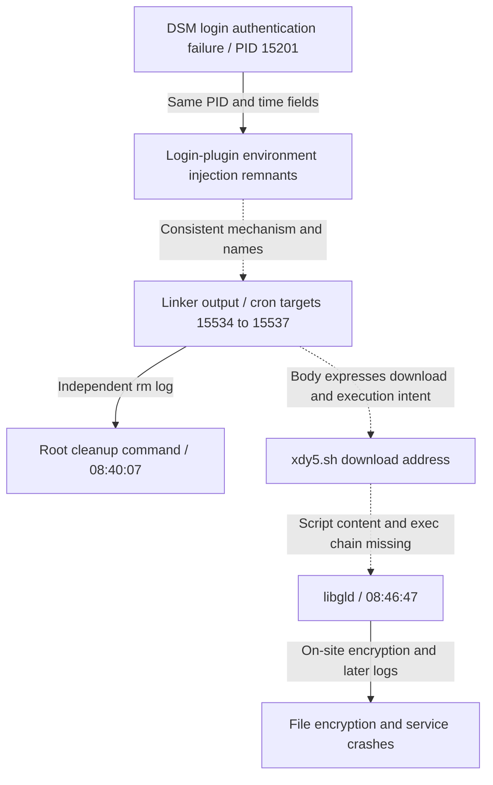

# Attack path and vulnerability assessment

English | [简体中文](attack-path_CN.md)

Updated 2026-10-29; times are Asia/Shanghai (UTC+8). This pass rechecked existing 16 GiB RAM, 68 decrypted logs, 13 unencrypted archive members and three logs appended after encrypted footers: 84 analysis inputs totaling 57,099,487 bytes. The preserved scheduler database was also examined. The original seal was not modified.

**The strongest current explanation for initial access is DSM login-plugin environment-variable injection, highly consistent with CVE-2024-10441.** Malicious input in memory, PID/time associations in the same log table, matching cron targets, residual linker output and the affected version support one another. The complete process chain from download script to `libgld` has not been obtained; the entire chain cannot be represented as step-by-step proven. No evidence supports the earlier assessment that a new GitLab RCE in October 2026 was the entry point.

This pass involved offline reading, decompression and structure checks only: no exploit replay, execution of recovered commands or contact with the download server. The public [evidence index](attack-path-evidence.json) records digests, offsets, line numbers and confidence; complete fragments, commands and raw logs remain local.

## Evidence timeline

| Time (2026-10-28, +08:00) | Evidence | Conclusion and limits |
|---|---|---|
| 08:26:42–08:28:30 | Static-file probes for `.env`, `.git` and similar in nginx error logs | Background scanning, not a record of successful exploitation; “gitlab” does not prove GitLab RCE |
| **08:39:24** | Decrypted auth.log line 14732: `SYNO.API.Auth_7_login`, PID **15201**, PAM authentication failure; the same 167-byte line found in RAM (E01) | Two preserved sources cross-check the line; failed login does not exclude a later plugin-processing exploit |
| **08:39:29.312774** | An index in one residual RAM log table associates PID **15201**, login-processing body, timestamp and `synoscgi.service` (E02) | Body includes plugin delimiter, environment variables and cron output path; time is a residual field, not a trusted timestamp service |
| Time not independently recovered | Residual plugin parameters include a user field, injected variable, `TYPE=passwd`, `SESSION=webui`, `API_VERSION=7`, `STATUS=fail`, `RESULT=-2` (E03) | Supports entry into post-login processing; fragment is partly damaged and is not a complete HTTP request |
| Time not independently recovered | Three LZO candidate blocks strictly decompress to 4096-byte pages containing linker debug remnants for **15534/15536** and encoded command fragments (E04) | Consistent with cron-target PID suffixes; not a complete cron file or execution log |
| **08:40:07** | Decompressed original `rm.log.1.xz` line 6762: PID **17377**, uid/euid 0, runs `rm -f` against four `synotgkk.15534` through `.15537` files (E05) | Confirms a root cleanup command was logged; alone it does not prove files existed, deletion succeeded or cron ran |
| **About 08:46:47** | On-site process record: root PID **21871** starts `/bin/libgld -n 308`; RAM also contains the same NUL-separated arguments and root environment remnants (E06) | Direct evidence of the encryptor and arguments; parent-process chain remains unreconstructed |
| **08:47:23** | Same rm log line 6763: PID **25246**, uid/euid 0, runs a command to delete `/bin/l0ck.enc` (E05) | Later operational lead; the file's content or role is not established |
| **08:48:10–08:48:59** | Area appended after messages' encrypted footer: Drive, Photos, indexing and other services crash; includes `libsynosyncserver.so.L0CK3D` (E07) | Supports system/package damage as a consequence of encryption and explains some management-page failures |
| 10:06:03–10:06:49 | New nginx logs show many more cross-product probes; administrator confirmed no scan was run | After encryption started; not evidence of the initial entry point |

The diagram shows evidence associations, **not a recovered process tree**. Dashed edges indicate execution relationships needing more evidence.

## New structural checks

### Login body, PID and time are associated by an index

The original region begins at RAM file offset `0x2932af000` and is 16384 bytes long. At `0x2932b03d0` a residual structure consistent with the syslog-ng **NVTable/NVEntry** layout was identified. Its header gives logical size 3488, used size 1940, 19 dynamic indices and nine static slots; 12 direct values can be located through the index and checked for length and NUL boundaries. Interpretation follows the [syslog-ng source header](https://raw.githubusercontent.com/syslog-ng/syslog-ng/syslog-ng-3.37.1/lib/logmsg/nvtable.h); this does not establish that version was installed on site.

| Indexed entry start (RAM file offset) | Field | Verified content |
|---|---|---|
| `0x2932b0a30` | `_SOURCE_REALTIME_TIMESTAMP` | `1793147969312774` microseconds |
| `0x2932b0a78` | `MESSAGE` | 317-byte login-processing body with injection and encoded command |
| `0x2932b0f08` | `_PID` | `15201` |
| `0x2932b0f44` | `SYSLOG_PID` | `15201` |
| `0x2932b0d6c` | `_SYSTEMD_UNIT` | `synoscgi.service` |

The header and entries above are in the same physical page. The logical table spans pages; adjacent physical pages were not mistaken for adjacent virtual pages, and cross-page fields were not used for conclusions. A reference-count byte of 0 also indicates a residual object, not proof of an active log object at capture time. This strengthens association within the same record but is not an authenticated complete journal export. [syslog-ng journal fields](https://syslog-ng.github.io/admin-guide/060_Sources/190_systemd-journal/README.html)

The critical decrypted auth.log line also exactly matches 167 bytes of RAM starting at `0x375c3ccc`, SHA-256 `2fd4082341d42ae345488a8c997665527908a48339708494f8b930d3d5e05468`. This checks that line's consistency across sources; it does not authenticate the entire log.

### A strings search cannot establish absence from compressed remnants

Bounded LZO analysis of hit regions accepted candidates only when `lzo1x_decompress_safe` returned 0, consumed the entire specified input and produced exactly 4096 bytes. Focused checks:

| RAM compressed-data start | Input bytes | Decompressed lead |
|---|---:|---|
| `0x363a89408` | 737 | Multiple PID 15534 `calling fini` linker lines; other remnants on the same page |
| `0x1cad16aa8` | 1263 | PID 15536 output fragment and a remnant matching **53/56 bytes** at the end of a known encoded command |
| `0x31239b7e8` | 447 | The same 15536 and 53-byte suffix fragments |

The missing three bytes were not reconstructed and presented as original text, and fragments were not assembled into a complete cron file. The LZO stream had no independent content checksum; successful decompression and semantic relevance are supporting evidence only. These blocks have not been mapped to a specific zram slot, process or inode, and compressed contents of all RAM were not exhaustively examined.

The raw-byte scan covered 25 fixed markers without truncation: `synotgkk` had 870 hits, the complete cron directory path five and the known encoded command four. Many hits are duplicate names/buffers and cannot be counted as 870 attacks. The plaintext download IP and script name had no direct hit; the address came from decoding an encoded field. The space-separated `libgld -n` string did not hit, but NUL-separated arguments existed, illustrating why the scope of negative byte searches must be stated.

## Vulnerability and entry-point assessment

Both preserved `/etc/VERSION` and `/etc.defaults/VERSION` say **DSM 7.2-64561, smallfix 0**. Synology SA-24:20 describes CVE-2024-10441 as unauthenticated remote code execution in the system plugin daemon, with **7.2-64570-4** as the fixed baseline for DSM 7.2. This was disclosed in 2024; this report does not claim a new vulnerability. Version files do not substitute for inspecting the actual binaries for patches. [Synology advisory](https://www.synology.com/en-global/security/advisory/Synology_SA_24_20)

Rapid7's original research connects delimiter/environment injection during post-login processing to writing dynamic-linker output to cron. This incident's variable structure, PID suffixes and failed-login processing match that mechanism. **Failed authentication does not mean exploitation failed**; `LD_PRELOAD` alone also does not establish an attack without context. [Rapid7 original research](https://www.rapid7.com/cdn/assets/bltad0709de42b54e82/689604359f008cdd02f69917/disguise-delimit-whitepaper.pdf)

User-provided router configuration forwarded ports 80/443, Drive and SSH to DSM; this only establishes exposure configuration observed after the fact. No request capture identifies the domain, port or upstream forwarding path used in this incident. The administrator opening the 5000 management page marks discovery of the anomaly, not proof that this normal login triggered encryption.

| Hypothesis | Current assessment |
|---|---|
| DSM CVE-2024-10441-related login-plugin injection | **High-confidence primary entry explanation**; local input, record structure, debug output, cleanup targets and version support each other |
| xdy5 download chain directly launched libgld | **Possible, but unproven end-to-end**; the contemporaneous script, successful download record and complete exec/parent chain are missing |
| GitLab RCE was the initial entry | **Not supported by available evidence**; static-path probes and error logs do not prove exploitation; the GitLab version observed at preservation was 19.5.1 |
| SSH password compromise or lateral movement from another internal device | **Unconfirmed and not fully excluded**; preserved logs are incomplete and failed authentication does not prove a successful login |
| Attacker identity, original public source or data exfiltration | **Undetermined**; traceable network/audit records are missing |

## IOCs and attribution limits

- Download target referenced by the encoded command: `hxxp://104[.]253[.]175[.]125/xdy5[.]sh`. This is a **payload-source lead, not a confirmed attacker-origin IP**. Decoded text is 41 bytes, SHA-256 `d912350a99fe2005dcf992cfdba2a4980fe7f30d865abe18fe50e492a2fb9a54`.
- Cron target prefix: `/etc/cron.d/synotgkk`; related suffixes `15534`, `15535`, `15536`, `15537`.
- Preserved encryptor SHA-256: `802ac85d19dc6db2b1849bb3499877280544d04a0ae94d4c408b6c321669903d`.
- File/runtime indicators: `.L0CK3D`, `read-me3.txt`, `libgld`, `init-rsysd.lo`; search leads only, not attribution on their own.

Addresses seen in authentication and nginx logs are gateway/NAT addresses, also used by administrator traffic, and cannot be identified as attacker addresses. A user-provided [Reddit post](https://www.reddit.com/r/synology/comments/1xhqgov/well_it_finally_happened_my_first_real_ransomware/) prompted this search; its download IP differs, and similar symptoms and names do not establish the same operator.

## Missing evidence and next steps

The most valuable additional evidence would be original DSM/plugin logs or complete requests from the attack, a contemporaneous copy of `xdy5.sh`, original cron content, process-creation audit records and traceable original-source records from upstream firewalls/reverse proxies. If found, correlate times and digests on isolated copies only; content downloaded from the site now cannot prove what was distributed then.

The complete RAM digest passed again; 128 checks of copy digests, record structures, plaintext-line comparison and focused LZO replay passed. Passing checks do not close the attack chain or prove logs were not tampered with. See the [log and memory correlation skill reference](../skills/dsm-ransomware-rescue/references/attack-trace.md) (Chinese) and [sealing record](evidence-seal.md) for the local additions and separate checkpoint.
