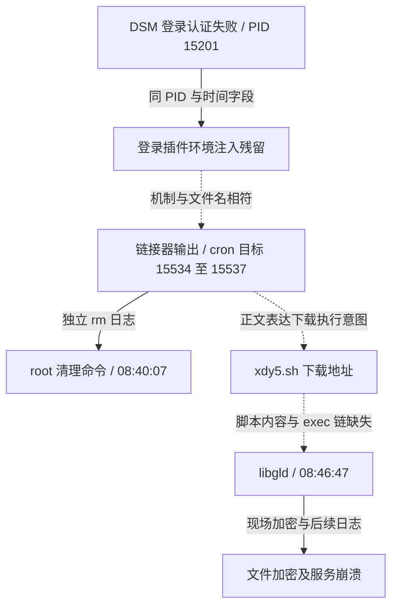

# 攻击路径与漏洞来源

[English](attack-path.md) | 简体中文

更新：2026-10-29；时间为 Asia/Shanghai（UTC+8）。本轮重新核对既有 16 GiB RAM、68 份解密日志、13 个未加密归档成员和 3 份加密尾记录后追加日志，共 84 个分析输入、57,099,487 字节。另检查了已保全的调度数据库。原始封存没有修改。

**目前最有力的入口解释是 DSM 登录插件环境变量注入，与 CVE-2024-10441 高度一致。** 内存中的恶意输入、同一日志表内的 PID/时间关联、同名 cron 目标、链接器输出残留及受影响版本相互支持。下载脚本与 `libgld` 之间的完整进程链尚未取得，不能把整个链条写成逐步证实。没有证据支持先前“GitLab 在 2026 年 10 月的新 RCE 是本案入口”的判断。

本轮只有离线读取、解压和结构校验，没有重放漏洞、执行恢复出的命令或联系下载服务器。公开的[证据索引](attack-path-evidence.json)保存摘要、偏移、行号和置信度；完整片段、命令和原始日志仅保存在本地。

## 证据时间线

| 时间（2026-10-28，+08:00） | 证据 | 结论与限制 |
|---|---|---|
| 08:26:42–08:28:30 | nginx 错误日志中的 `.env`、`.git` 等静态文件探测 | 扫描背景；不是成功利用记录，含 gitlab 字样也不证明 GitLab RCE |
| **08:39:24** | 解密 auth.log 第 14732 行：`SYNO.API.Auth_7_login`，PID **15201**，PAM 认证失败；该行 167 字节又在 RAM 原样找到（E01） | 两种保全材料交叉校验了该行；登录失败不排除后续插件处理触发漏洞 |
| **08:39:29.312774** | RAM 中同一残留日志表索引关联 PID **15201**、登录处理正文、时间戳和 `synoscgi.service`（E02） | 正文含 plugin delimiter、环境变量及 cron 输出路径；时间来自残留字段，不是可信时间戳服务 |
| 时间未独立恢复 | 插件参数残留含用户字段、注入变量、`TYPE=passwd`、`SESSION=webui`、`API_VERSION=7`、`STATUS=fail`、`RESULT=-2`（E03） | 支持进入登录后处理；片段部分损坏，不冒充完整 HTTP 请求 |
| 时间未独立恢复 | 三个 LZO 候选块严格解压成 4096 字节页面；含 **15534/15536** 的链接器调试残留和编码命令片段（E04） | 与 cron 目标的 PID 后缀吻合；不是完整 cron 文件或执行日志 |
| **08:40:07** | 原 `rm.log.1.xz` 解压后第 6762 行：PID **17377**、uid/euid 0，执行 `rm -f`，目标为四个 `synotgkk.15534` 至 `.15537` 文件（E05） | 确认记录了 root 清理命令；不单独证明文件存在、删除成功或 cron 已执行 |
| **约 08:46:47** | 现场进程记录：root 的 PID **21871** 启动 `/bin/libgld -n 308`；RAM 另有 NUL 分隔的相同参数及 root 环境残留（E06） | 加密程序与参数有直接证据；尚未重建父进程链 |
| **08:47:23** | 同一 rm 日志第 6763 行：PID **25246**、uid/euid 0，执行删除 `/bin/l0ck.enc` 的命令（E05） | 后续操作线索；未据此确定该文件内容或作用 |
| **08:48:10–08:48:59** | messages 加密 footer 后追加区：Drive、Photos、索引等服务崩溃；含 `libsynosyncserver.so.L0CK3D`（E07） | 支持系统/套件损坏是加密后的后果，解释部分管理页面异常 |
| 10:06:03–10:06:49 | 新 nginx 日志又出现大量跨产品探测，管理员确认未运行扫描 | 发生在加密启动后，不能作为最初入口证据 |

下图是证据关联，**不是已经恢复的进程父子树**。虚线表示仍需补证的执行关系。

## 本轮新增的结构校验

### 登录正文、PID、时间存在索引关联

原区域从 RAM 文件偏移 `0x2932af000` 开始，长 16384 字节。此次在 `0x2932b03d0` 识别到与 syslog-ng **NVTable/NVEntry** 布局相符的残留结构。表头给出的逻辑大小 3488、已用 1940、19 个动态索引、9 个静态槽；12 个直接值可以通过索引定位并检查长度及 NUL 边界。结构解释依据 [syslog-ng 原始头文件](https://raw.githubusercontent.com/syslog-ng/syslog-ng/syslog-ng-3.37.1/lib/logmsg/nvtable.h)，不据此认定现场安装了该版本。

| 索引指向的条目起点（RAM 文件偏移） | 字段 | 已核对内容 |
|---|---|---|
| `0x2932b0a30` | `_SOURCE_REALTIME_TIMESTAMP` | `1793147969312774` 微秒 |
| `0x2932b0a78` | `MESSAGE` | 317 字节登录处理正文，含注入与编码命令 |
| `0x2932b0f08` | `_PID` | `15201` |
| `0x2932b0f44` | `SYSLOG_PID` | `15201` |
| `0x2932b0d6c` | `_SYSTEMD_UNIT` | `synoscgi.service` |

表头和上述条目都在同一物理页内。逻辑表跨页，未把相邻物理页误接为相邻虚拟页；跨页字段未用于结论。引用计数字节为 0，也提醒这是残留对象，不能据此认定采集时仍有有效日志对象。它加强了同一记录的关联，仍不是经过认证的完整 journal 导出。[syslog-ng journal 字段说明](https://syslog-ng.github.io/admin-guide/060_Sources/190_systemd-journal/README.html)

另外，解密 auth.log 的关键行与 RAM `0x375c3ccc` 开始的 167 字节完全一致，SHA-256 为 `2fd4082341d42ae345488a8c997665527908a48339708494f8b930d3d5e05468`。这是该行的跨材料一致性检查，不提升为整个日志真实可信的证明。

### 压缩残留不能靠 strings 判定缺失

对命中区域做有界 LZO 分析，以 `lzo1x_decompress_safe` 返回 0、完整消耗指定输入、输出恰为 4096 字节作为候选条件。重点复核：

| RAM 压缩数据起点 | 输入字节 | 解压后的线索 |
|---|---:|---|
| `0x363a89408` | 737 | PID 15534 的多条 `calling fini` 链接器输出；同页也有其他残留内容 |
| `0x1cad16aa8` | 1263 | PID 15536 输出片段，与已知编码命令末尾 **53/56 字节**一致的残留 |
| `0x31239b7e8` | 447 | 同样的 15536 与 53 字节后缀片段 |

没有把缺失的 3 字节补回后冒充原文，没有把残片拼成完整 cron 文件。LZO 流没有提供独立内容校验码；输出可解压、语义相关只是支持证据。尚未将这些块映射到具体 zram 槽、进程或文件 inode，也没有穷尽整个 RAM 的压缩内容。

本轮原始字节扫描 25 个固定标记，均未截断：`synotgkk` 命中 870 次，完整 cron 目录路径 5 次，已知编码命令 4 次。大量命中是重复名称/缓冲区，不能计为 870 次攻击。明文下载 IP 和脚本名未直接命中；下载地址来自编码字段的解码。`libgld -n` 空格串未命中，但 NUL 分隔的参数存在，说明阴性字节搜索的范围必须写清。

## 漏洞与入口判断

现场保存的 `/etc/VERSION` 和 `/etc.defaults/VERSION` 均为 **DSM 7.2-64561，smallfix 0**。Synology SA-24:20 将 CVE-2024-10441 描述为 system plugin daemon 中可导致未认证远程代码执行的问题，DSM 7.2 分支修复基线为 **7.2-64570-4**。这是 2024 年已公告的问题；此处不是声称发现了新漏洞。版本文件不能替代实际二进制补丁鉴定。[Synology 公告](https://www.synology.com/en-global/security/advisory/Synology_SA_24_20)

Rapid7 原始研究将登录后处理中的 delimiter/environment 注入与动态链接器输出写入 cron 的方法连接起来。本案的变量结构、PID 后缀和失败登录处理都与其吻合。**认证失败并不意味着利用失败**；也不能仅由出现 `LD_PRELOAD` 判断攻击，必须结合完整上下文。[Rapid7 原始研究](https://www.rapid7.com/cdn/assets/bltad0709de42b54e82/689604359f008cdd02f69917/disguise-delimit-whitepaper.pdf)

用户提供的路由配置有到 DSM 的 80/443、Drive 和 SSH 转发；它只能说明事后看到的暴露配置。尚无请求捕获来确定本次利用经过哪个域名、端口或上游转发路径。管理员打开 5000 管理页是发现异常的时间点，不能据此说该次正常登录触发了加密。

| 假设 | 当前判断 |
|---|---|
| DSM CVE-2024-10441 相关登录插件注入 | **高可信的主要入口解释**；本机输入、记录结构、调试输出、清理目标及版本相互支持 |
| xdy5 下载链直接启动 libgld | **可能，但未闭环**；没有取得当时脚本、成功下载记录及完整 exec/父子链 |
| GitLab RCE 是初始入口 | **现有材料不支持**；静态路径探测与错误日志不能证明利用，保全时实际 GitLab 版本为 19.5.1 |
| SSH 密码被破解或从其他内网设备横向进入 | **未证实，也未完全排除**；保留日志不完整，失败认证记录不足以证明成功登录 |
| 确认攻击者身份、原始公网来源或数据外传 | **未确定**；缺少可追溯网络/审计记录 |

## IOC 与归因边界

- 编码命令引用的下载目标：`hxxp://104[.]253[.]175[.]125/xdy5[.]sh`。这是**载荷来源线索，不是已确认的攻击发起 IP**。解码文本 41 字节，SHA-256：`d912350a99fe2005dcf992cfdba2a4980fe7f30d865abe18fe50e492a2fb9a54`。
- cron 目标前缀：`/etc/cron.d/synotgkk`；相关后缀 `15534`、`15535`、`15536`、`15537`。
- 已保全加密程序 SHA-256：`802ac85d19dc6db2b1849bb3499877280544d04a0ae94d4c408b6c321669903d`。
- 文件/运行特征：`.L0CK3D`、`read-me3.txt`、`libgld`、`init-rsysd.lo`；只作为检索线索，单独出现不能证明归属。

认证及 nginx 中看到的是网关/NAT 地址，管理员流量也以该地址出现，不能当作攻击者地址。用户提供的 [Reddit 帖子](https://www.reddit.com/r/synology/comments/1xhqgov/well_it_finally_happened_my_first_real_ransomware/)促成了此次检索；对方下载 IP 与本案不同，症状和名称相似不足以认定同一操作者。

## 尚缺材料与继续方式

最有价值的补证是攻击时的 DSM/plugin 原日志或完整请求、`xdy5.sh` 的当时副本、原 cron 内容、进程创建审计，以及上游防火墙/反向代理中可追溯的原始来源记录。若找到，只在隔离副本上关联时间和摘要；现在重新从下载站取得的内容不能证明当时分发了什么。

本轮完整 RAM 摘要重新通过；128 项副本摘要、记录结构、明文行比对和重点 LZO 重放检查通过。检查通过不代表攻击链已闭环，也不证明日志未被攻击者篡改。取证经验见 [skill：日志与内存关联](../skills/dsm-ransomware-rescue/references/attack-trace.md)，本地新增材料与独立封存检查点见 [封存记录](evidence-seal_CN.md)。
